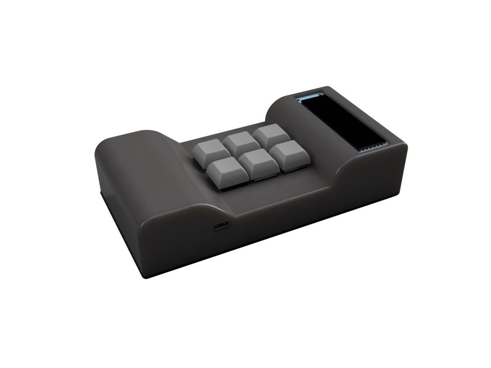
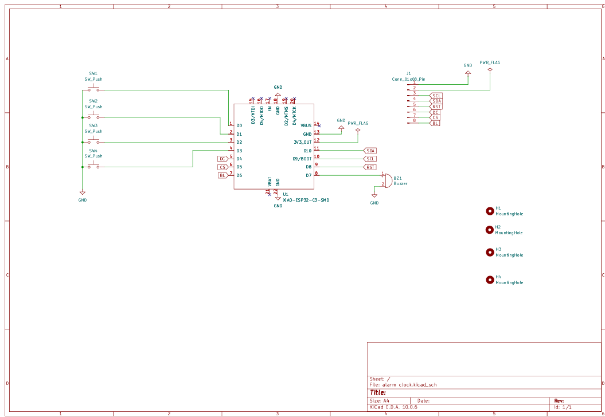
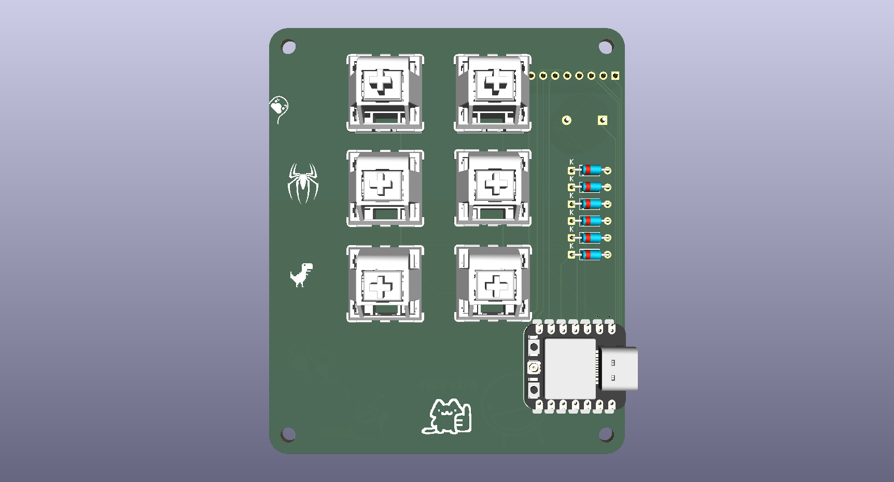
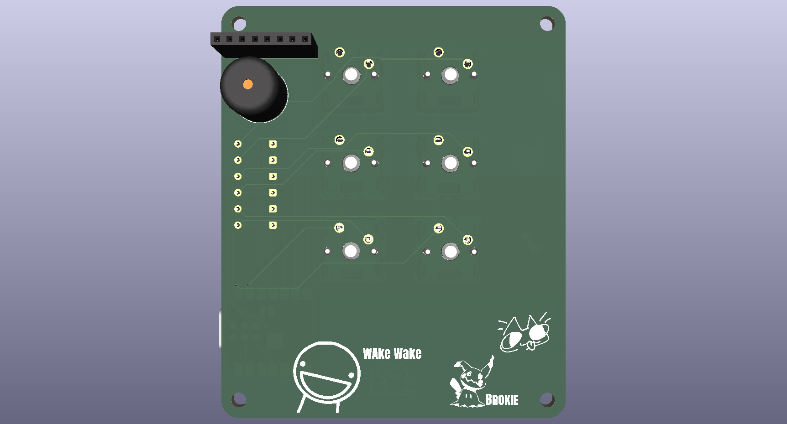
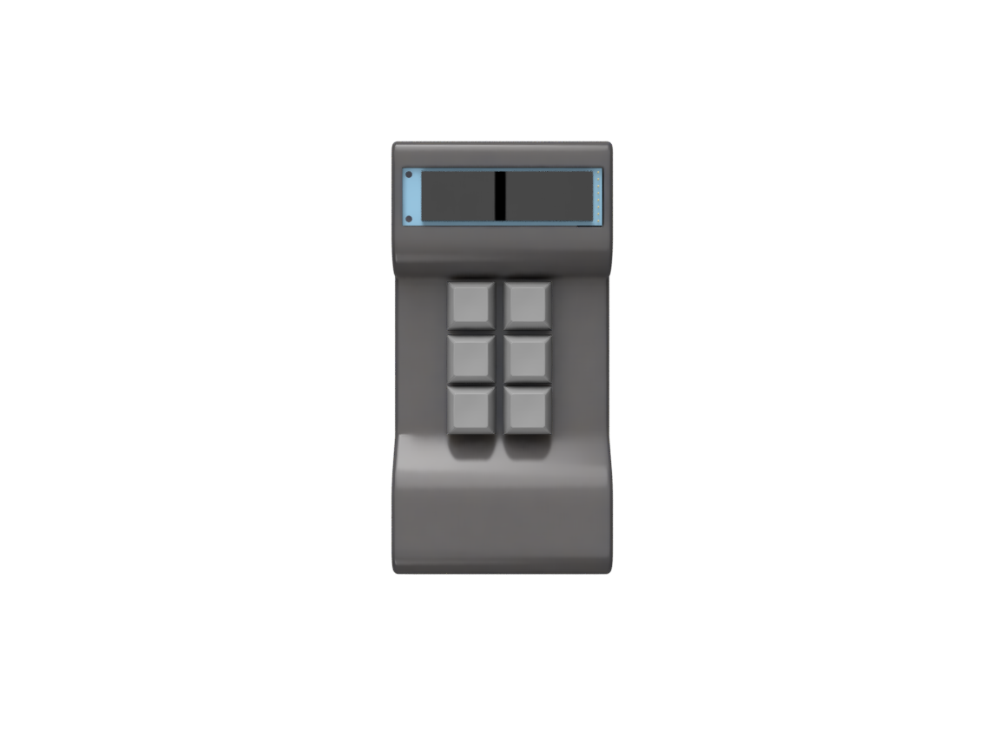

# Wake_up

An alarm clock based on the retro brick phone customized for your own prefrence and style.

## Description

This is a custom alarm clock that I made while I was scrolling Pinterest I saw an old 90s brick phone and I got the idea to make an alarm clock for my room that looks like an brick phone although its not as polished as my imagination but as a beginner it has been a great project for me 

### Screenshots
- Schematics

- PCB

- Case

## Getting Started
- Download PCB Files
- Download Arduino IDE
- Install ESP32 board on Arduino IDE
- Download Firmware file

### Dependencies

#Libraries

- Adafruit GFX Library
- Adafruit ST7735 and ST7789 Library

### Executing program

- Open Arduino IDE
- Open *[alarm_firmware](Firmware/alarm_firmware.ino)* 
- Flash the firmware to ESP32 C3

## License

This project is licensed under the [NAME HERE] License - see the LICENSE.md 
